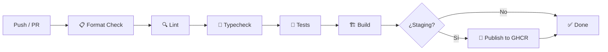

# Integración continua

GitHub Actions verifica los pushes y pull requests dirigidos a `develop`, `staging` y `main`. El pipeline controla formato, lint, tipos, tests y el build de producción.



## Publicación de imágenes

Los pushes a `staging` publican dos etiquetas de la imagen en **GitHub Container Registry**:

```
ghcr.io/typeitorg/bemol-ui:sha-<sha-del-commit>   # Inmutable
ghcr.io/typeitorg/bemol-ui:<rama>                  # Puntero a la última imagen exitosa
```

> [!WARNING]
> Los repositorios remotos ya fueron renombrados a Bemol. La publicación de la
> nueva imagen y la migración de permisos y referencias externas siguen pendientes;
> ver [Despliegue](DEPLOYMENT.md) antes de desplegar.

> [!IMPORTANT]
> Los despliegues **deben usar la etiqueta inmutable** `sha-<sha-del-commit>`. La etiqueta de rama es solamente un puntero conveniente.
